# 平台核心操作链路

> 文档基于 2026-08-27 本地运行版本整理。界面截图来自当前平台与实际示例项目。

## 整体链路

基于 Azure 图像生成、OCR 与大语言模型能力，平台面向电商及品牌营销场景，以“商品事实、参考素材、页面模板、生成配方”为统一生产输入，构建从资料录入到多 SKU 交付的端到端智能内容生产链路。业务人员完成商品参数、核心卖点、品牌要求及参考图上传后，LLM 结合版式约束自动规划多页内容结构、标题正文和图文卖点；图像模型依据配方中的 Prompt、模型参数、生成质量、参考图策略与候选数量，生成商品新角度、应用场景、材质光影及原生卖点视觉，平台再通过独立文字图层完成可编辑排版，实现底图与营销文案分层。生产结果由 OCR、确定性规则和 LLM 多模态审查共同校验文字准确性、商品一致性、版式安全区、品牌规范及视觉质量，并结合自动修复、单页重生、自然语言定向改图、AI 文字重排和 Human-in-the-loop 人工审核形成质量闭环。方案以版式库和生成配方沉淀可复用的品牌生产标准，以版本管理、问题证据及人工覆盖记录提供全过程审计，同时支持多候选择优、长图拼接、完整交付包导出和多 SKU 批量编排，在保留人工精调能力的前提下，提升内容生产效率、品牌一致性、质量可控性与规模化复用能力。

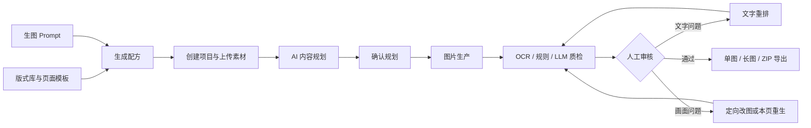

## 先理解五个核心对象

| 对象 | 作用 |
| --- | --- |
| 版式库 | 一个库固定一个画布尺寸，例如 2048×2048、3840×2160；用于分类和管理同尺寸页面。 |
| 页面模板 | 定义某一页的安全区、文字预留框、商品允许区、商品核心区和图文卖点区；已发布模板修改时创建新版本。 |
| 生图 Prompt | 定义画面风格、场景、材质、光影和禁止项，不负责主标题、正文的最终排字。 |
| 生成配方 | 把 Prompt、模型、默认质量、参考图策略、候选数、可用模板和质检策略固定成可复用方案。实际生产时可临时覆盖质量。 |
| 项目 | 保存商品事实、素材、内容规划、生成候选、质检、审核和导出记录。 |

## 1. 项目首页与环境状态

进入平台后先查看左下角环境状态。管理员/专家可以进入版式中心和生成配置；业务用户主要使用项目与批量任务。项目首页可以搜索、筛选、创建或复制项目，也可以直接打开内置示例查看完整结果。

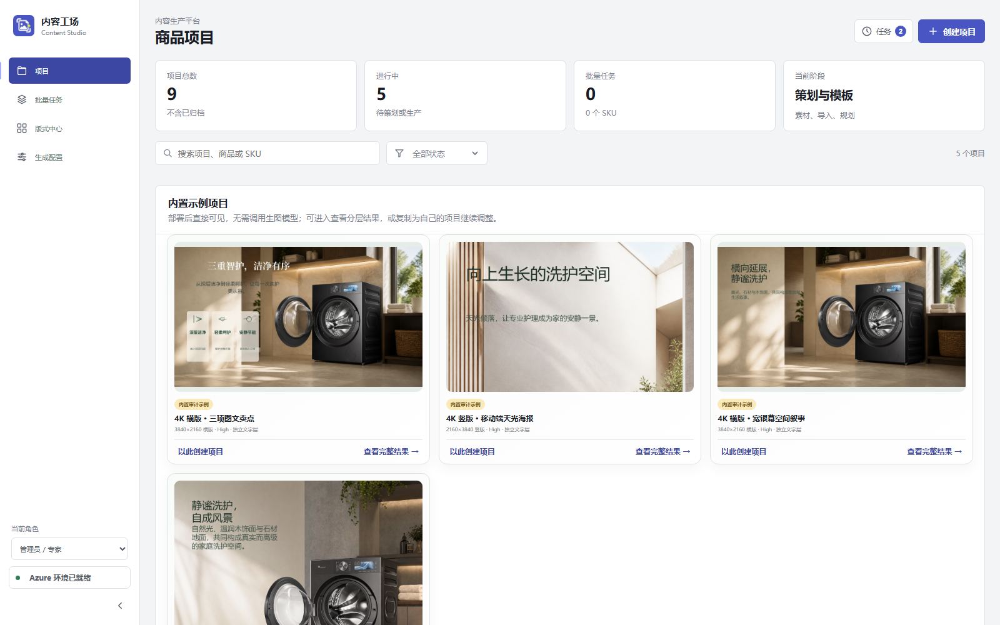

常用操作：

1. 点击“创建项目”建立单商品项目。
2. 点击示例的“以此创建项目”，复制一套可运行配置再替换商品资料。
3. 点击“查看完整结果”直接检查示例的生产、质检和导出效果。
4. 右上角“任务”用于查看规划、生图、重生和定向改图等异步任务状态。

## 2. 配置版式库与页面模板

版式库先确定输出尺寸和宽高比；库内每个已发布页面模板，对应项目初始规划中的一个页面。横版、竖版和方形会按真实比例缩放预览，不按实际像素大小显示。

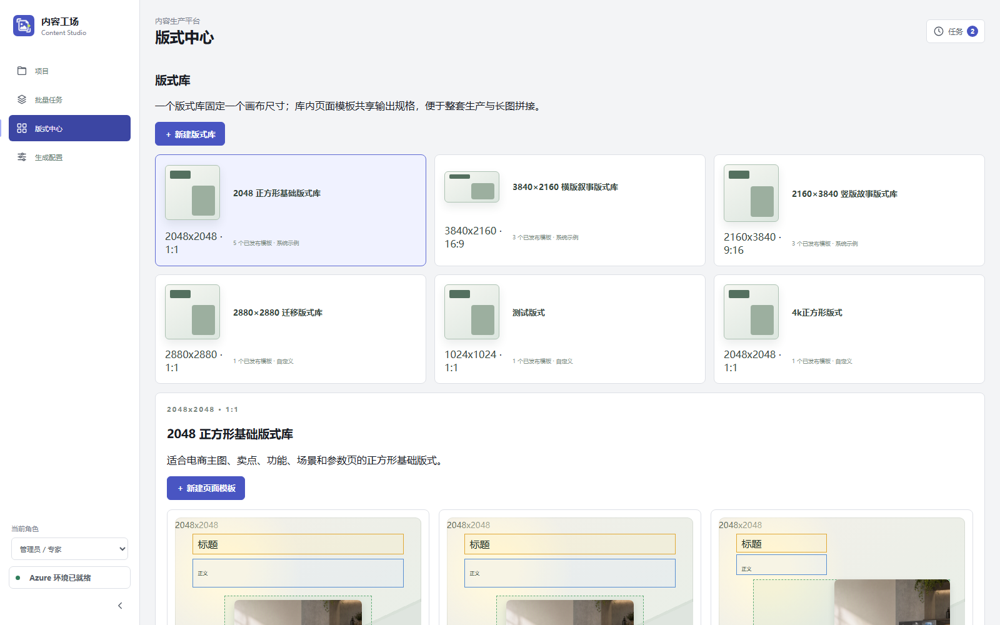

创建流程：

1. 点击“新建版式库”，选择预设尺寸或填写模型支持范围内的自定义尺寸。
2. 进入版式库，点击“新建页面模板”。
3. 设置模板名称、适用页面类型和场景提示。
4. 在画布中拖拽或缩放文字框、图文卖点区、商品允许区和商品核心区。
5. 保存草稿并发布。已发布模板不能原地覆盖，继续修改会创建新版本。

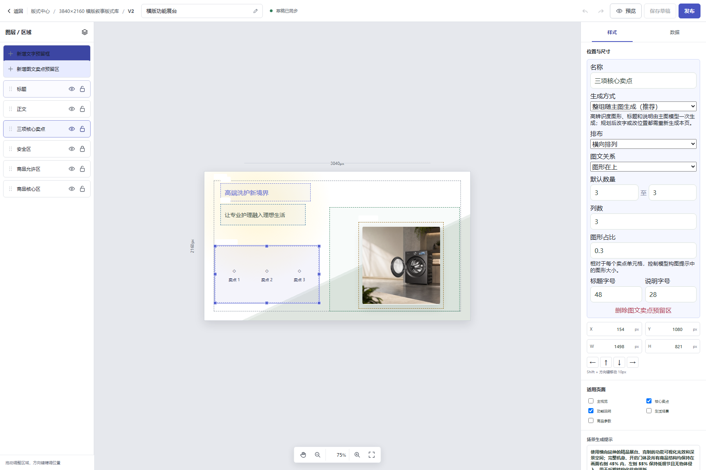

区域含义：

- **文字预留框**：告诉生图模型哪里应保持低细节留白，并作为后期文字层的初始位置。
- **图文卖点区**：约束模型在指定区域内原生生成图形、卖点短标题和说明；不是独立 PNG 图标贴图。
- **商品允许区**：商品完整结构不得越出的范围。
- **商品核心区**：商品视觉重心建议落入的范围。
- **安全区**：文字和卖点模块不能越出的最终边界。

## 3. 配置 Prompt 与生成配方

生成配置页顶部展示一张图的实际组装关系：页面模板 + 参考素材 + 生图 Prompt + 生成配方，最终形成模型图与后期文字层。

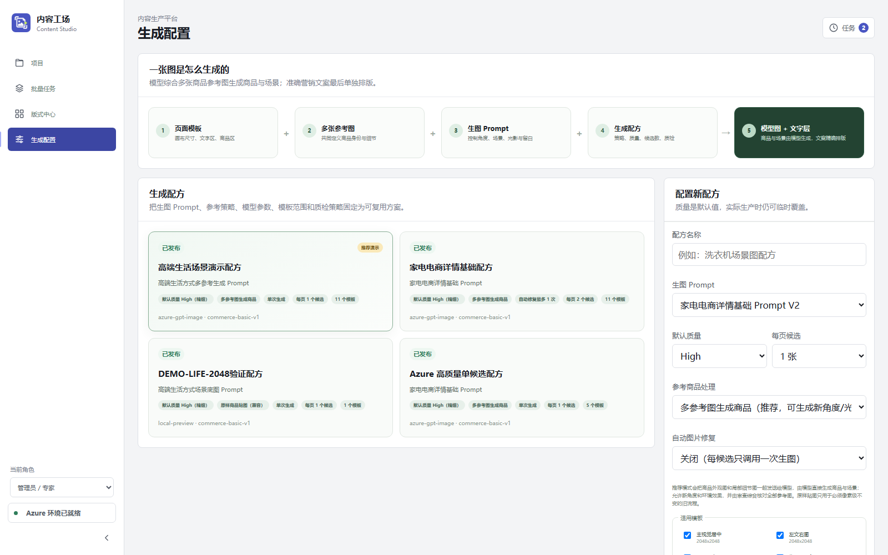

配置顺序：

1. 创建或发布一个生图 Prompt，描述场景、风格、材质、光影、构图偏好和禁止项。
2. 新建配方并选择已发布 Prompt。
3. 设置默认质量（Low / Medium / High）、每页候选数、参考图策略和自动修复次数。
4. 勾选配方允许使用的页面模板版本。
5. 测试后发布配方；草稿配方不能进入正式生产。

实际生图时，系统会把**配方 Prompt、模板构图约束、项目商品事实、页面视觉目标、参考素材和图文卖点内容**组装成每页指令。主标题与正文不交给图片模型绘制，而是生成透明文字层后合成；采用“整组随主图生成”的图文卖点内容会进入生图指令。

## 4. 创建项目、填写商品资料与上传素材

创建项目时需要选择版式库，因此页面数量、尺寸和比例从一开始就受到约束。进入项目后，在“商品资料”维护商品事实并上传参考素材。

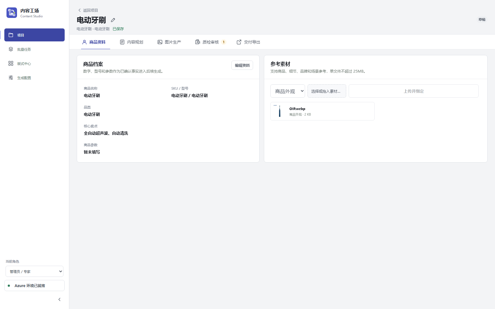

建议填写：

- 商品名称、SKU/型号、品类、核心卖点和已确认参数；数字参数会进入事实校验。
- 品牌要求、禁用表达和本次输出要求。
- 商品外观、局部细节、品牌或场景参考图。商品/细节图会作为多参考图交给图片模型，用于生成新角度、材质表现和环境融合。

## 5. AI 内容规划与人工确认

“内容规划”按所选版式库中的模板建立页面。AI 会结合商品事实、参考图和模板约束，建议每页标题、正文、视觉目标及图文卖点；建议不会直接覆盖当前草稿。

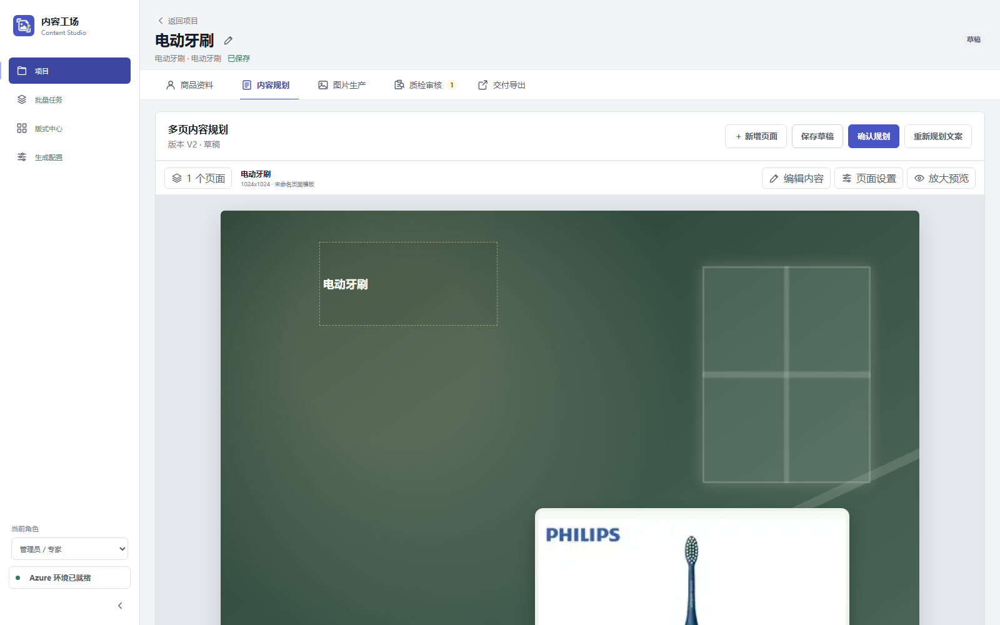

操作方式：

1. 点击“AI 生成内容规划”或“重新规划文案”。
2. 规划完成后，可按页或按字段采用建议，也可以直接人工修改。
3. 使用“新增页面”、排序、页面类型和模板选择调整页面结构。
4. 编辑图文卖点的标题、说明和视觉概念；修改原生卖点内容后需要重新生成对应页面。
5. 保存草稿，确认无误后点击“确认规划”。确认后才开放图片生产。

重新规划会生成新的建议和版本；连接失败时会返回失败或降级状态，不应无限停留在“规划中”。

## 6. 图片生产与候选选择

图片生产页选择已发布配方和本次质量后开始生产。质量覆盖只影响当前任务，不会修改原配方。页面会显示总体进度、各页排队/运行/完成/失败状态、耗时、参考图数量和候选结果。

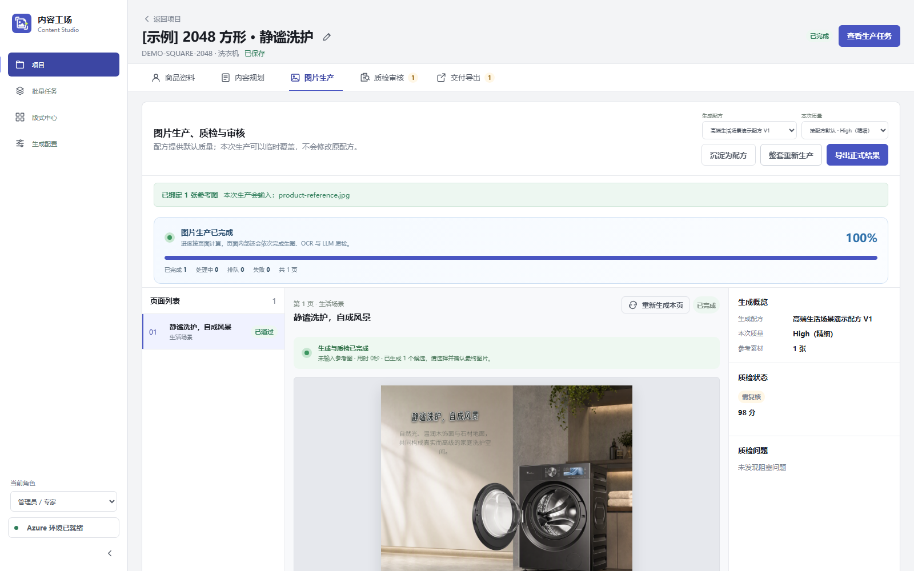

可以执行：

- 每页生成 1—3 个候选并选择最终候选。
- 只重新生成某一页，或整套重新生产。
- 对某张候选输入自然语言要求，修改背景、场景、角度、材质或光影；系统保留原候选，只重跑目标页。
- 纯文字、字号、颜色和位置修改应使用“文字重排”，不会再次调用图片模型。
- 将已验证项目“沉淀为配方”，交由管理员测试和发布。

## 7. 质检、文字重排与定向改图

质检审核会综合后期文字层、OCR、模板几何、商品事实、参考一致性、品牌规则、视觉质量和 LLM 审查，并在画布上显示问题标注。右侧可以查看问题、建议动作和审核记录。

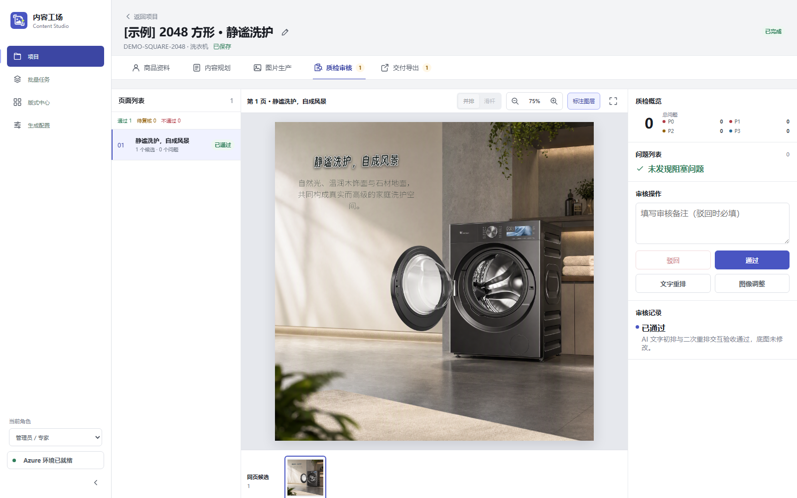

问题等级：

- **P0**：确定性硬规则失败，例如关键事实或安全区错误。
- **P1**：有明确证据的重大问题，默认阻止直接确认。
- **P2**：需要关注或人工确认，不自动阻止确认。
- **P3**：提示性观察或轻微建议。

审核动作：

1. **文字重排**：打开文字图层工作台，加载当前候选真实字体与排版。
2. **图像调整**：用自然语言只修改当前候选的无字底图，再重新排版和质检。
3. **驳回**：返回修改或重新生成；高风险问题需要填写原因。
4. **通过**：确认当前候选为页面最终结果；存在 P0/P1 时人工覆盖必须记录原因。

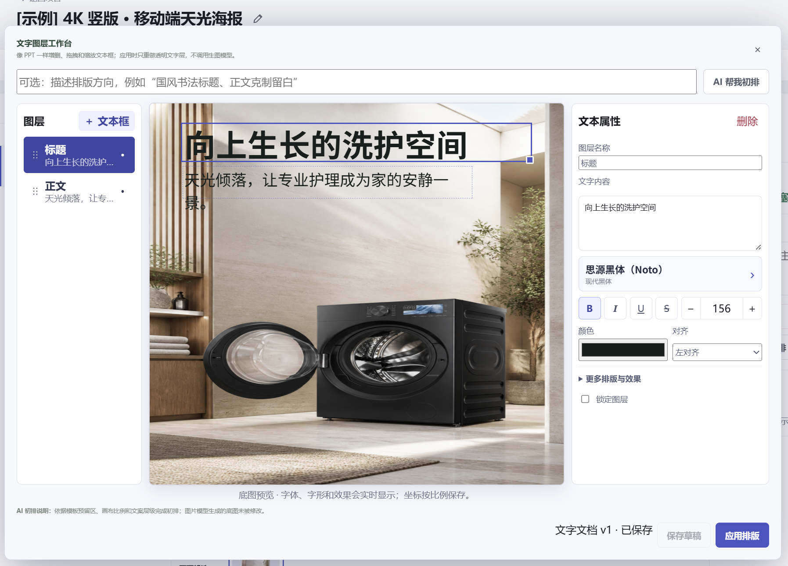

文字工作台支持像 PPT 一样新增、删除、拖拽和缩放文本框，并设置字体、字号、粗体、斜体、下划线、删除线、颜色、对齐、行距、字距、描边和阴影。字体库展示真实字形预览，只提供有明确可商用许可记录的字体。点击“AI 帮我初排/重新排”会创建文字文档新版本；点击“应用排版”生成新候选，底图保持不变，之后可手动质检或填写说明跳过自动质检。

## 8. 交付导出与长图拼接

全部页面确认后进入“交付导出”。单页项目直接导出交付包；多页项目可以先选择候选、调整顺序，再设置纵向/横向、间距、背景色和对齐方式，生成保持原分辨率的 PNG 长图。

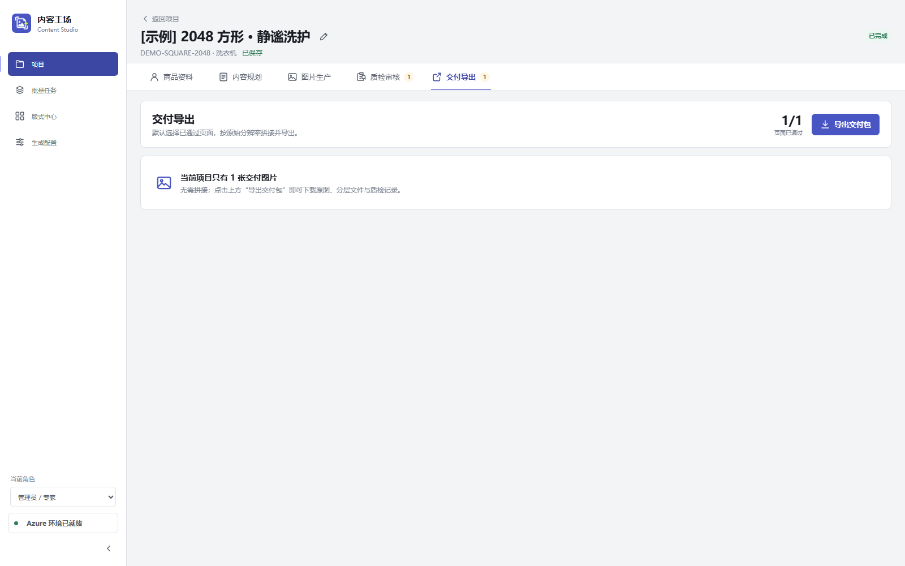

正式 ZIP 通常包含最终合成图、无营销文字底图、透明文字层、QA/审核记录和项目摘要，便于复核、二次编辑和审计。

## 9. 多 SKU 批量生产

批量任务复用同一套配方和单项目流程，适合一批 SKU 的标准化生产。

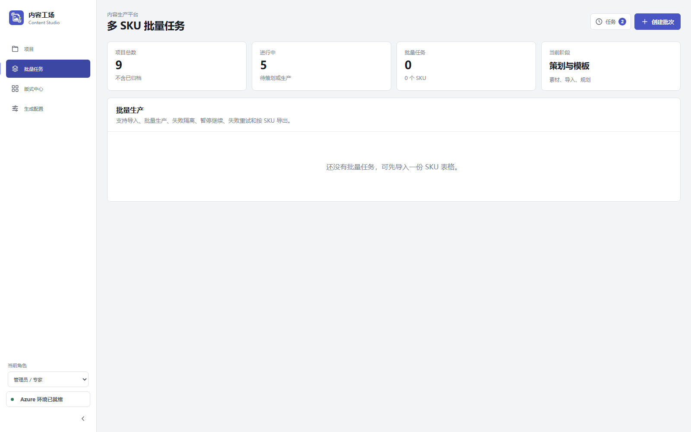

操作方式：

1. 点击“创建批次”，快速录入 SKU，或导入 CSV/XLSX。
2. 为整批选择配方并启动生产，每个 SKU 建立独立项目和任务。
3. 查看整批与单 SKU 进度；失败项相互隔离，可暂停、继续或只重试失败项。
4. 审核各 SKU 结果后，按 SKU 目录批量导出。

## 最小演示路径

如果只需要快速演示一遍完整闭环，可以采用以下路径：

1. 在项目首页复制一个内置示例。
2. 替换商品资料和至少一张商品外观参考图。
3. 选择同尺寸版式库，运行 AI 内容规划并确认一页。
4. 选择已发布配方，以 High 质量生成 1 个候选。
5. 检查质检标注；分别演示一次文字重排或定向改图。
6. 通过该页并导出正式交付包。

生产前如左下角不是“环境已就绪”，先处理 Azure 生图、OCR 和 LLM 审查配置；功能回归也可切换到本地模式，避免外部服务影响流程验证。
